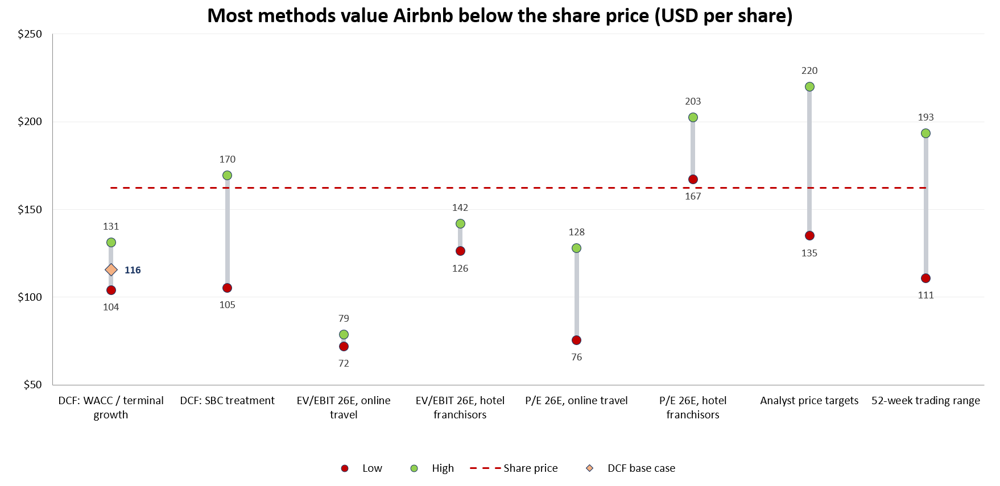
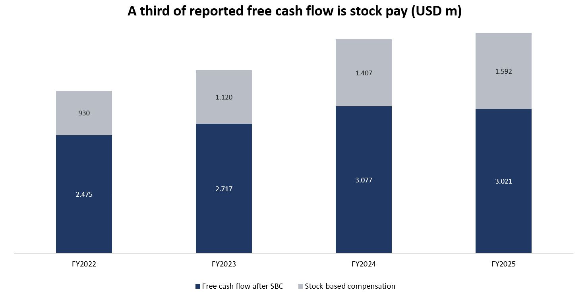
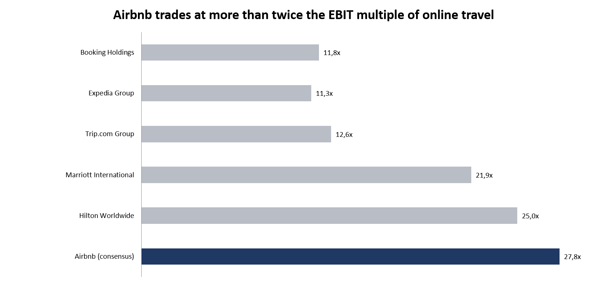
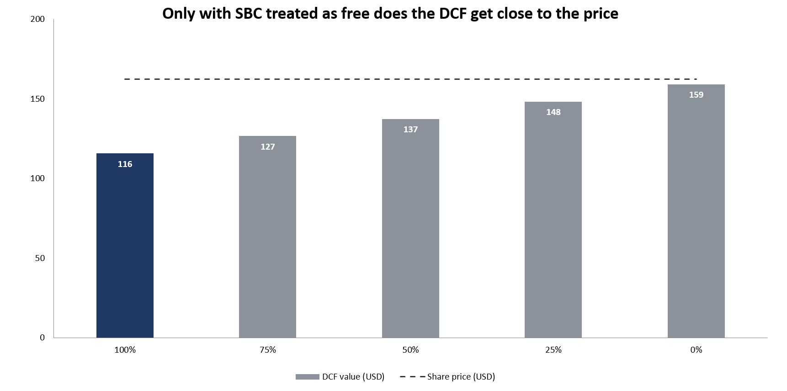
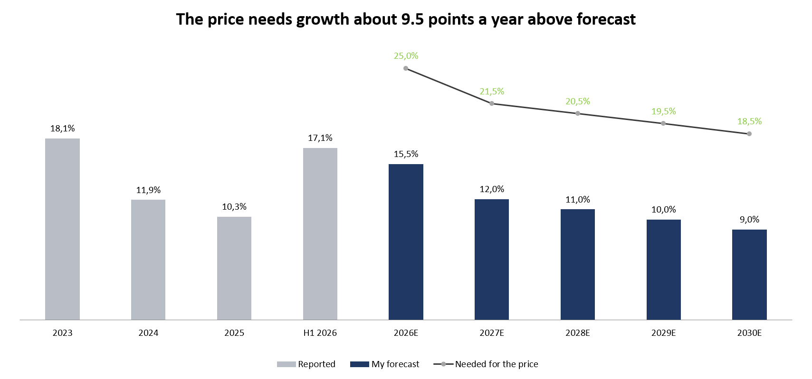

# Airbnb (ABNB): Fundamental Analysis and Valuation

**My rating: SELL. Price target $116 vs. a share price of $162.43 on 2 October 2026, so about 29% downside.**

I did Company Valuation and Corporate Finance at university, but always on textbook cases with clean numbers. I wanted to value a real company once from start to finish, from the shareholder letters and filings to a price target I can defend. I picked Airbnb because I know the product, it's big enough to have good public data, and there is a real debate around it: a great business, but how much is it actually worth?

This repo has my research note and the Excel model behind it. All charts below come from the model. I learned a lot of things along the way, and I wrote down the most important ones at the end.

## The call at a glance

| | |
|---|---|
| Share price (2 Oct 2026) | $162.43 |
| My DCF value per share | **$116** |
| Upside / downside | **−29%** |
| Rating (BUY / SELL if more than 15% away from the price) | **SELL** |
| Analyst consensus (43 analysts) | Outperform, average target $184 |
| Market cap / net cash (end of 2025) | $97.3bn / $9.0bn |
| EV / EBIT 2026E | 27.8x (online travel peers 11.8x, hotel franchisors 23.5x) |
| P/E 2026E | 30.7x |
| WACC / terminal growth | 10.0% / 3.0% |
| DCF value if SBC is ignored | $159 |

My short version: Airbnb is a very good business, but the share price only works if you treat stock-based compensation as free. I don't think it is.

## The business in numbers

| | 2023 | 2024 | 2025 | H1 2026 |
|---|---|---|---|---|
| Revenue growth | 18.1% | 11.9% | 10.3% | 17.1% |
| Nights booked, growth | 13.8% | 9.7% | 8.4% | 9.7% |
| Average daily rate, growth | 1.9% | 1.8% | 2.9% | 7.1% |
| Take rate (revenue / bookings) | 13.5% | 13.6% | 13.4% | n.m. |
| EBIT margin (2023 without one-off tax reserves) | 24.7% | 23.0% | 20.8% | 13.4% |
| Free cash flow margin | 38.7% | 40.4% | 37.7% | 47.0% |
| SBC in % of revenue | 11.3% | 12.7% | 13.0% | 14.3% |
| Free cash flow after SBC, margin | 27.4% | 27.7% | 24.7% | 32.8% |
| SBC in % of free cash flow | 29% | 31% | 35% | 30% |
| Buybacks / SBC | 2.0x | 2.4x | 2.4x | 2.4x |
| Change in diluted share count | −2.6% | −2.6% | −3.4% | −4.3% |

The half-year numbers look odd at first. Guests pay when they book, so cash flow in H1 is high. Revenue is only recognised at check-in, and the summer is still to come, so the H1 margin is low. H1 2026 growth also includes about 3 points of currency tailwind. I left the H1 take rate out because bookings run ahead of revenue in a half year, so the ratio doesn't mean much.

## Why SELL

### 1. Most valuation methods land below the share price

My DCF gives $104–131 across reasonable WACC and growth assumptions. On EBIT multiples Airbnb would be worth $72–79 at online travel valuations and $126–142 at hotel franchisor valuations. Among the multiples, only the P/E of Marriott and Hilton ($167–203) gets above today's price.

### 2. A third of the free cash flow is paid in shares

Reported free cash flow was $4.6bn in 2025, but $1.6bn of that is stock-based compensation. It is added back because no cash leaves the company, but shareholders still pay for it: Airbnb spends $3.8bn a year on buybacks, and a large part of that only cancels the new employee shares. After SBC, free cash flow has been flat at about $3.0bn for two years.

### 3. The shares are priced far above the peers

I compare on EV/EBIT because it includes SBC for every company. Airbnb's "adjusted EBITDA" leaves $1.6bn of stock pay out, while the peers have much less. Airbnb grows faster than everyone in the group, but at 27.8x EBIT it is more than twice as expensive as the online travel agencies and even above the hotel franchisors.

### 4. The price only works if stock pay is free

With the same forecast, the DCF moves from $116 to $159 when SBC is added back to free cash flow, which is roughly where the shares trade. So the market price assumes that stock-based pay is not a real cost.

### 5. Or growth has to be much higher than anyone expects

My forecast is within 2.5% of consensus for 2028. To get to $162 with everything else unchanged, one of these would have to be true:

| To justify $162 | Needed | My base case |
|---|---|---|
| WACC | 7.8% | 10.0% |
| Terminal growth | 5.5% | 3.0% |
| Revenue growth 2026–30 | +9.5 points every year | 15.5% falling to 9% |
| Terminal EBIT margin | 46% | 28% (Booking today: ~33%) |

## What would change my view

- SBC falling clearly below 10% of revenue
- Services, Experiences or hotels lifting revenue growth above 15% in 2027
- A lasting drop in long-term interest rates (1 point lower WACC adds about $17 per share)

## What I learned along the way

- **The numbers are never all in one place.** I collected them from five shareholder letters, the 10-K and the 10-Q. Line items also change between years: in 2024 Airbnb merged interest expense into "other income", so I had to rebuild the older years to make them comparable. I recalculated EBIT, pre-tax income and net income from their parts and checked that they tie to the reported figures for every period.
- **"Adjusted" metrics need a second look.** I first wanted to compare on EV/EBITDA, until I saw that Airbnb's adjusted EBITDA excludes $1.6bn of SBC. Against peers with little SBC, that makes Airbnb look much cheaper than it is, so I switched to EV/EBIT and P/E. This ended up being the main point of the whole analysis.
- **Not all cash on the balance sheet belongs to the company.** Airbnb holds about $7bn of guest payments until check-in. They sit on the balance sheet, but an equal liability sits on the other side. Counting them as cash would add more than $11 per share that isn't really there.
- **Small inputs can move results.** For Trip.com I first used a rough USD-CNY rate of 7.10. The actual rate on the analysis date was 6.70 (FRED), which changed Trip.com's EV/EBIT from 13.4x to 12.6x and the top of the online travel range. Since then I take every input from a dated source.
- **The base case is only one point.** I used Excel data tables to see how the value moves with WACC, terminal growth, the terminal margin and the SBC treatment. A reverse DCF then asks the question the other way round: what would I have to believe to pay today's price?
- **Smaller technical choices matter too:** mid-year discounting, rolling the value from the balance-sheet date to the analysis date, Blume-adjusted beta, treating the convertible notes as debt because they were repaid in cash, and using diluted shares so that unvested employee shares count.

## Skills used

- **Financial statement analysis:** income statement, cash flow and balance sheet from SEC filings and shareholder letters; KPIs like the take rate, average daily rate and quality of earnings
- **Valuation:** DCF (unlevered free cash flow, WACC with CAPM, terminal value), trading comps, a football field, sensitivity tables and a reverse DCF
- **Excel modelling:** live formulas throughout, a separate inputs sheet with sources, data tables and charts linked to the model
- **Writing:** a compact research note with a clear rating and the risks to it

## Files

| File | What it is |
|---|---|
| `Airbnb_Research_Note.pdf` | The research note: business model, competition, financials, quality of earnings, valuation, risks |
| `Airbnb_Valuation_Model.xlsx` | The model: inputs, historicals, WACC, DCF with sensitivity tables, trading comps, football field, charts and sources |
| `fig1` – `fig5` (`.png`) | The charts in this README, exported from the model |

In the model, blue numbers are inputs (each with its source next to it), black are formulas and green are links between sheets. "n.m." marks figures that exist but are not meaningful, such as a take rate for a half year.

## Data

Company figures come from Airbnb's shareholder letters (Q4 2022, Q4 2023, Q2 2025, Q4 2025, Q2 2026), the 10-K 2025 and the 10-Q for Q2 2026. Consensus estimates, peer data and price targets are from MarketScreener, the 10-year Treasury yield from ycharts and the equity risk premium from Damodaran (August 2026). All market data is as of 2 October 2026; a few peer prices are from up to a week before or after. The full list of links is on the Sources sheet of the model.

This is a personal learning project, not investment advice.
